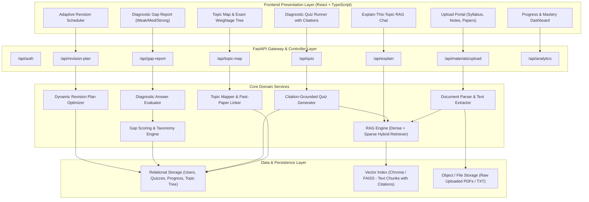
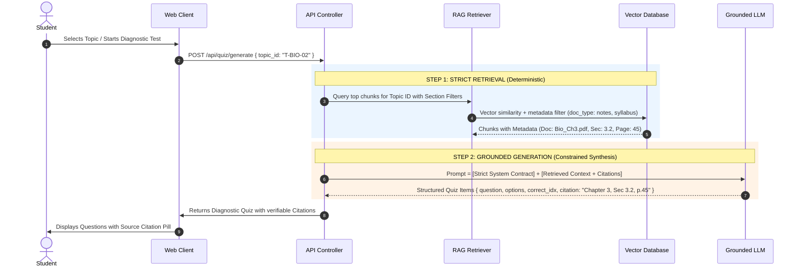
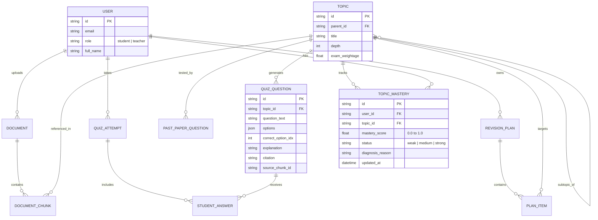

# System Architecture & Technical Design: GapFinder AI

## 1. High-Level Architecture Overview

GapFinder AI is built on a clean, decoupled client-server architecture designed around a **Retrieval-Augmented Diagnostic Engine**. The architecture explicitly separates **Retrieval** (ground truth extraction from student notes and syllabus) from **Generation** (question authoring, gap diagnostic reasoning, and revision scheduling).

---

## 2. Separation of Concerns: Retrieval vs. Generation

A critical requirement of the hackathon problem statement is guaranteeing that AI generated content does not hallucinate or use external out-of-syllabus web knowledge.

### Retrieval Layer Duties:
- Deterministic extraction of raw text from PDFs, Markdown, and TXT files.
- Chunking by semantic boundaries (headers, markdown sections, paragraphs) to avoid splitting definitions.
- Tagging chunks with rich metadata: `{ "document_name": "photosynthesis.pdf", "chapter": "Light Reactions", "section": "Photophosphorylation", "page": 14 }`.
- Similarity search restricted to the student's own collection.

### Generation Layer Duties:
- Strictly bound by system instructions: *“Never introduce facts or concepts not found within `<context>`. If the retrieved context is insufficient, return an empty set or request clarification.”*
- Producing structured JSON conforming to schema types with mandatory citation attributes.

---

## 3. End-to-End User Flow & Processing Pipeline

### Phase 1: Material Ingestion & Syllabus Decomposition
1. Student uploads:
   - **Syllabus**: Outlines topics, subtopics, and official learning objectives.
   - **Textbooks / Notes**: Source content for explanations and questions.
   - **Past Exam Papers**: Questions from previous years.
2. The `TopicMapper` parses the syllabus into a hierarchy tree (`Subject -> Chapter -> Topic -> Subtopic`).
3. Past-paper questions are parsed and semantically linked to syllabus nodes to assign an **Exam Frequency / Weightage Score** ($W_{\text{exam}}$).

### Phase 2: Diagnostic Assessment
1. The student triggers a diagnostic test (e.g., across the entire syllabus or a selected unit).
2. For each topic, the `QuizGenerator` retrieves candidate chunks and synthesizes diagnostic questions (Multiple Choice and Conceptual Short Answer).
3. Every generated question has an explicit citation (e.g., `Ref: NCERT Chapter 4, Sec 2.1`).

### Phase 3: Diagnostic Gap Analysis
1. The student submits answers.
2. The `Evaluator` grades answers against source definitions and constructs clear rationales for why options are correct or incorrect.
3. The `GapAnalyzer` computes mastery per subtopic:
   - **Accuracy**: Percentage of correct questions.
   - **Confidence & Error Depth**: Missed conceptual questions carry higher penalty than rote memory misses.
4. Topics are classified into:
   - 🔴 **Weak**: Mastery $< 50\%$ or foundational misconceptions detected.
   - 🟡 **Medium**: Mastery $50\% - 75\%$, partial grasp.
   - 🟢 **Strong**: Mastery $> 75\%$, consistent accuracy.

### Phase 4: Dynamic Revision Plan Formulation
1. Student inputs available revision budget (e.g., 5 days, 2 hours/day = 10 total hours).
2. The `PlanOptimizer` prioritizes topics using the objective function:
   $$\text{Priority Score} = \alpha \cdot (1 - \text{Mastery}) + \beta \cdot \text{Exam Weightage} + \gamma \cdot \text{Prerequisite Urgency}$$
3. Produces a scheduled day-by-day study roadmap focusing first on high-weightage weak areas.

### Phase 5: Targeted "Explain This Topic" & Re-Testing
1. Student clicks on any 🔴 Weak topic to open the **Explain-This-Topic** assistant.
2. The assistant retrieves relevant excerpts from the student's notes and presents a tailored explanation with interactive citations.
3. The student takes a short follow-up micro-quiz on that topic.
4. When score improves, the mastery score updates in real-time, shifting the topic from 🔴 Weak to 🟡 Medium or 🟢 Strong, and automatically reorganizing the revision plan.

---

## 4. Database Entity-Relationship Model

