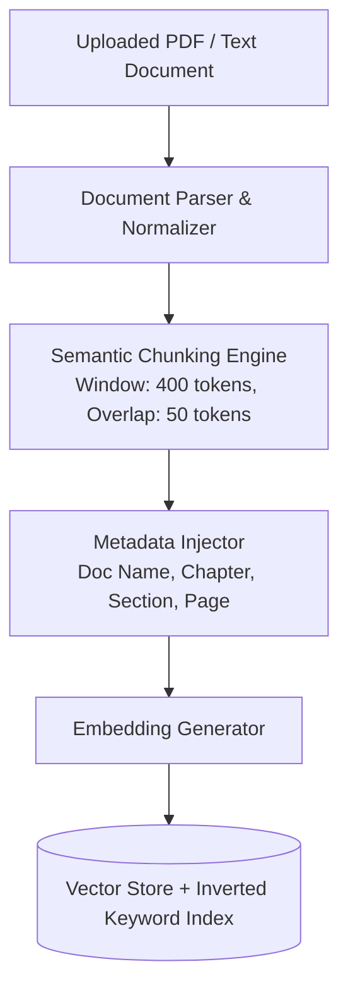

# RAG Pipeline & Anti-Hallucination Architecture

## 1. Core Principle

The hackathon guidelines explicitly mandate:
> *"A clear explanation of where retrieval is used, where generation is used, and how the two are kept separate."*
> *"Question generation grounded in retrieved content, not the model’s memory."*
> *"Explain-this-topic assistant that answers only from the uploaded material."*

GapFinder AI enforces a **Strict Guarded RAG Architecture** (SG-RAG) ensuring no ungrounded generation leaks into diagnostic quizzes or learning explanations.

---

## 2. Document Processing & Ingestion Workflow



### 2.1 Chunking Strategy
- **Semantic Section Splitting**: Documents are pre-parsed using markdown/PDF outline structures (H1, H2, H3 headers).
- Rather than naive fixed character chunking, chunks respect paragraph and heading boundaries.
- Chunks have an upper bound of 400 tokens with a 50-token context overlap to prevent cutting definitions mid-sentence.

### 2.2 Metadata Enrichment
Every chunk stored in the vector database is tagged with immutable provenance:
```json
{
  "chunk_id": "chk_bio_ch3_014",
  "document_id": "doc_bio_ch3",
  "document_name": "chapter_photosynthesis.pdf",
  "chapter_title": "Chapter 3: Photosynthesis in Higher Plants",
  "section_heading": "3.2 The Electron Transport Chain & Z-Scheme",
  "page_number": 14,
  "token_count": 312,
  "content_hash": "e9b2c8f..."
}
```

---

## 3. Grounded Question Generation Pipeline

When generating diagnostic questions:
1. **Query Construction**: The topic identifier and syllabus learning objectives form the search query.
2. **Dense + Sparse Hybrid Retrieval**:
   - Dense retrieval (vector similarity) surfaces conceptually matching passages.
   - Sparse retrieval (BM25) guarantees exact matches for technical terminology, chemical names, and formula references.
   - Chunks with low relevance scores ($< 0.72$) are filtered out.
3. **Prompt Envelope**:
   The prompt encapsulates the retrieved passage with strict system boundaries:

```markdown
SYSTEM:
You are an academic diagnostic test author. You MUST generate questions strictly and exclusively from the provided <CONTEXT> blocks below.
RULES:
1. Under NO circumstances use external scientific knowledge or assumptions not explicitly verified in <CONTEXT>.
2. Every question must test a factual or conceptual mechanism present in the context.
3. You must output the exact citation identifying the section and page where the answer is confirmed.
4. Output must be strictly valid JSON conforming to the DiagnosticQuestion schema.

<CONTEXT>
[Doc: chapter_photosynthesis.pdf | Section: 3.2 Z-Scheme | Page: 14]
"The whole scheme of transfer of electrons, starting from PS II, uphill to the acceptor, down the electron transport chain to PS I, excitation of electrons, transfer to another acceptor, and finally downhill to NADP+ causing it to be reduced to NADPH + H+ is called the Z-scheme, due to its characteristic shape."
</CONTEXT>

TASK: Generate a diagnostic multiple-choice question testing the terminal electron acceptor in the non-cyclic Z-scheme.
```

---

## 4. Citation Integrity & Verification

To satisfy the user requirement: *"Each question shows where it came from (for example, 'Chapter 3, Section 2'). That's the citation."*

Every diagnostic item contains an immutable `CitationRef`:
- **Document Title**: Source textbook / notes file.
- **Section Heading**: Contextual section where the fact is asserted.
- **Page Number / Chunk Anchor**: Verifiable anchor.
- **Verbatim Evidence Anchor**: A 1-2 sentence snippet from the source text that justifies the correct answer.

---

## 5. "Explain-This-Topic" Strict Boundary Enforcement

For the conversational tutor:
1. If the student asks about a concept that is **not** covered in their uploaded notes or syllabus:
   - The assistant explicitly responds:
     > *"This topic is not covered in your uploaded syllabus or notes. To keep your exam revision focused, GapFinder AI only explains concepts found in your prescribed material."*
2. No internet searches or broad LLM pre-training assumptions are pulled into the explanation.
3. Interactive UI pills display citations directly alongside every generated paragraph.

